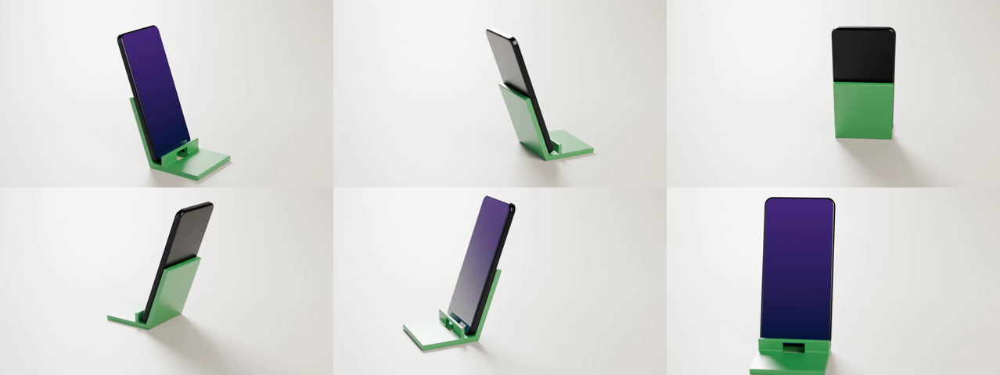
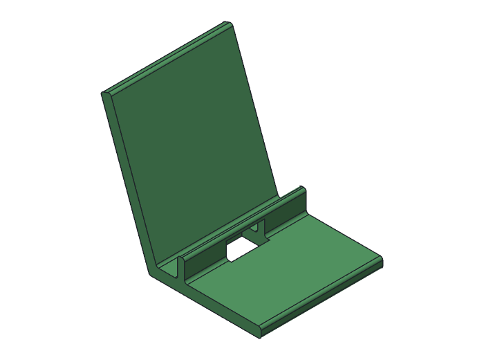
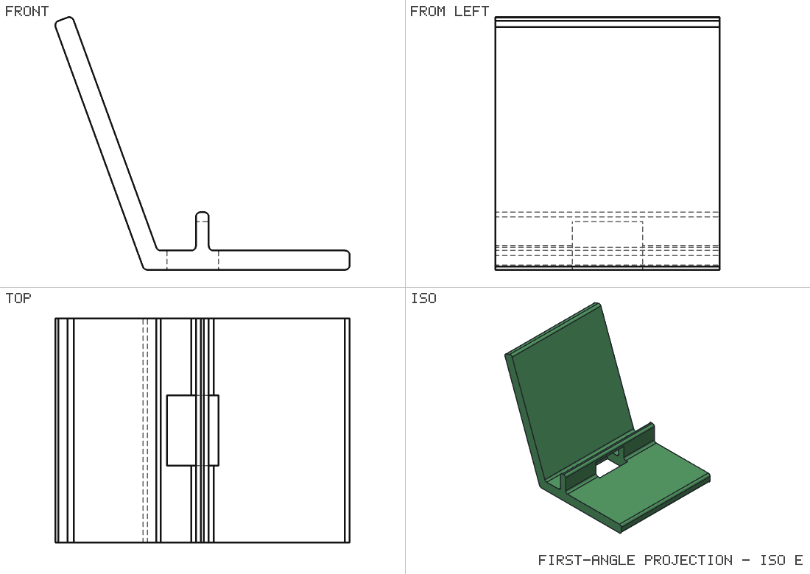

# Phone stand: smlibpy → Blender Cycles

A small phone stand modelled in Python with [smlibpy](https://github.com/awv-informatik/smlibpy)
(an exact-B-rep CAD kernel), then rendered as a product turntable in Blender's Cycles path tracer.

▶ **[Watch the 6-second showcase video](media/phone_stand_showcase.mp4)** (MP4, 1280×720)



| | |
|---|---|
|  |  |

## The part

- Base 90 × 70 × 6 mm with a 6 mm back leaning 20° rearward, a 4 × 18 mm lip, and a 16 × 22 mm cable slot
- 1.5 mm rounds on the profile edges
- Volume 60,065.5 mm³, about 74.5 g in PLA
- Outputs in `models/`: `stand.step` (exact geometry), `stand.stl` (for printing), and `stand.glb` / `phone.glb` (meshes for Blender)

## Rebuild it

```bash
pip install smlibpy
python phone_stand.py                     # models/*.step|stl|glb, media/stand_*.png

blender -b -P showcase.py -- models render                          # 144 PNG frames (6 s, 24 fps)
blender -b -P showcase.py -- models render --still 1 --samples 32   # one test frame
ffmpeg -framerate 24 -i render/frames/f_%04d.png -c:v libx264 -crf 17 -pix_fmt yuv420p \
       -movflags +faststart media/phone_stand_showcase.mp4
```

Tested with smlibpy 0.2.3 and Blender 5.2.2. The video was rendered at 1280×720 with 32 samples
per pixel (`--samples 32 --res 1280x720`), which took about an hour on a 4-core CPU. The
defaults are 1920×1080 and 64 samples.

## The scene (`showcase.py`)

- Cycles on CPU, OpenImageDenoise, AgX view transform
- A curved backdrop and three disc area lights (key, fill, rim)
- Materials: satin green plastic for the stand, dark aluminium for the phone, and a glossy screen with a blue-to-violet glow
- One full 360° turn, so the video loops, with a slow camera push-in and a shallow depth of field

Known nit: at the end of the push-in the front edge of the base is slightly cropped.
